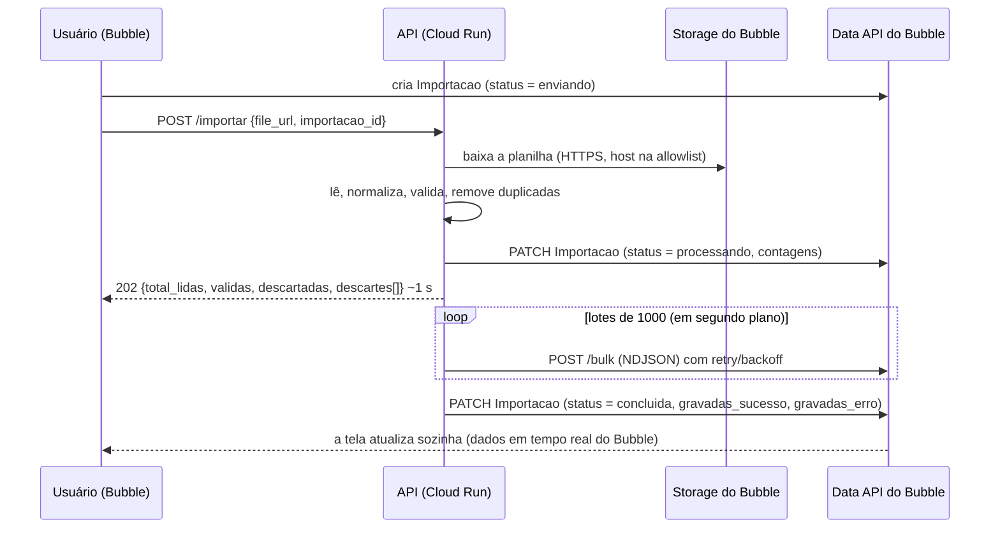

# Bubble Sheet Importer

[](https://github.com/rafaelyan07/bubble-sheet-importer/actions/workflows/testes.yml)


API que importa planilhas de conciliação financeira (≈5 mil linhas/mês) para um app **no-code feito em [Bubble](https://bubble.io)**:
baixa o arquivo enviado pelo usuário, limpa e valida os dados e grava tudo no banco do Bubble em lotes,
devolvendo o resultado em tempo real na tela.

> Projeto real em produção. Nomes, domínio e data types foram trocados por genéricos; a planilha em
> [`exemplos/`](exemplos/) é fictícia.

---

## O problema

O relatório mensal chega como uma planilha Excel exportada de outro sistema, e importá-la direto no Bubble
não funcionava:

- **Dados sujos**: CPFs que perderam o zero à esquerda no Excel (`1234567890` em vez de `012.345.678-90`),
  datas em vários formatos (`31/01/2026`, `01/2026`, `jan/2026`, número serial do Excel), valores como
  `R$ 1.234,56`, nomes com espaços duplicados e acentuação inconsistente, linhas duplicadas.
- **Volume**: criar 5 mil registros um a um pelos workflows do Bubble é lento e caro (workload units).
- **Tempo de resposta**: gravar 5 mil linhas leva ~1 minuto, mais que o tempo de espera de uma chamada
  do API Connector do Bubble.

## A solução



**Resultado**: o usuário sobe o arquivo e recebe a resposta em **menos de 2 s**. As ~4,8 mil linhas são gravadas
em **~1 minuto** pelo endpoint bulk, com o progresso aparecendo na tela.

## Destaques técnicos

| | |
|---|---|
| **Processamento assíncrono** | Resposta `202` imediata com o resumo do tratamento; a gravação roda em `BackgroundTasks` e o status final é escrito de volta no registro `Importacao`, que o Bubble exibe em tempo real. |
| **Gravação em lote** | Endpoint `/bulk` da Data API (NDJSON, até 1000 registros por chamada) em vez de 5 mil requisições. A resposta é lida linha a linha para saber exatamente quais registros falharam. |
| **Resiliência** | Retry com backoff exponencial + jitter em `429`/`5xx`/erros de rede, respeitando `Retry-After`. Um lote que falha não derruba os outros. |
| **Tratamento de dados** | Funções puras e testadas para CPF, datas, valores e textos; agrupamento de categorias por regex; remoção de duplicadas por chave configurável; motivo do descarte com o número da linha no Excel. |
| **Segurança** | API key com comparação em tempo constante; proteção contra SSRF (só HTTPS, allowlist de hosts revalidada a cada redirect, limite de tamanho em streaming); validação do formato dos ids; segredos no Secret Manager; contêiner sem root. |
| **Observabilidade** | Logs JSON estruturados, um evento por etapa (`download`, `leitura`, `tratamento`, `bubble_bulk`, `fim`), prontos para o Cloud Logging. |
| **Qualidade** | 88 testes com `pytest` (HTTP simulado com `httpx.MockTransport`, sem rede), rodando no GitHub Actions junto com o build da imagem Docker. |
| **Deploy** | Docker no Google Cloud Run (região São Paulo) com deploy contínuo a partir do GitHub e custo dentro da camada gratuita. |

## Regras de tratamento

| Coluna da planilha | Campo | Tratamento |
|---|---|---|
| Nome do Servidor | `nome` | maiúsculas, sem acento, espaços extras removidos (**obrigatório**) |
| CPF do Servidor | `cpf` | formata `xxx.xxx.xxx-xx` e repõe zeros perdidos pelo Excel; dígito verificador opcional (**obrigatório**) |
| Mês da Conciliação | `data` | ISO 8601; aceita data do Excel, `dd/mm/aaaa`, `mm/aaaa`, `aaaa-mm`, `jan/2026` (**obrigatório**) |
| Descr. Motivo da Conciliação | `motivo` | maiúsculas, sem acento |
| Descrição da Espécie | `tipo_cobranca` | agrupa variações (ex.: "Seguro de Vida em Grupo" → `SEGURO`) |
| Valor Averbado | `valor` | aceita `1.234,56`, `R$ 1.234,56`, `1234.56` (**obrigatório**) |
| Número da Averbação | `averbacao` | texto; desfaz o float do Excel (`12345.0` → `12345`) |

- Os nomes das colunas são comparados ignorando acento, caixa e espaços.
- Campos vazios são omitidos (o Bubble não recebe `null`).
- Duplicadas são definidas por `CHAVE_DUPLICIDADE` (padrão `cpf,data,tipo_cobranca,valor`).

## Estrutura

```
app/
  main.py            FastAPI: POST /importar (202 + background), GET /health
  tratamento.py      leitura da planilha e regras de limpeza (funções puras)
  bubble_client.py   cliente da Data API: bulk em lotes, PATCH, retry/backoff
  arquivo.py         download seguro (allowlist, só HTTPS, redirects validados, limite de tamanho)
  config.py          configuração por variáveis de ambiente
  logging_config.py  logs JSON
tests/               88 testes (pytest)
exemplos/            planilha fictícia para testar
Dockerfile
```

## Rodando localmente

```bash
python -m venv .venv
source .venv/bin/activate          # Windows: .venv\Scripts\activate
pip install -r requirements-dev.txt
pytest

cp .env.example .env               # preencha API_KEY, BUBBLE_APP_URL e BUBBLE_API_TOKEN
uvicorn app.main:app --reload      # com EXPOR_DOCS=true, docs em http://localhost:8000/docs
```

```bash
curl -X POST http://localhost:8000/importar \
  -H "X-API-Key: SUA_CHAVE" -H "Content-Type: application/json" \
  -d '{"file_url": "//xxxx.cdn.bubble.io/f123/planilha.xlsx", "importacao_id": "1791222659057x452330323960370400"}'
```

Resposta (`202`):

```json
{
  "importacao_id": "1791222659057x452330323960370400",
  "status": "processando",
  "total_lidas": 7,
  "validas": 3,
  "descartadas": 4,
  "descartes": [
    {"linha": 5, "motivo": "nome vazio"},
    {"linha": 6, "motivo": "cpf vazio"},
    {"linha": 7, "motivo": "valor inválido: 'abc'"},
    {"linha": 8, "motivo": "duplicada da linha 2"}
  ]
}
```

## Deploy (Google Cloud Run)

```bash
gcloud run deploy bubble-sheet-importer --source . --region southamerica-east1 \
  --allow-unauthenticated --timeout 600 --memory 1Gi \
  --no-cpu-throttling --min-instances 0 --max-instances 1 \
  --set-env-vars BUBBLE_APP_URL=https://seu-app.bubbleapps.io,BUBBLE_ENV=live \
  --set-secrets API_KEY=api-key:latest,BUBBLE_API_TOKEN=bubble-token:latest
```

- `--no-cpu-throttling` é necessário: sem ele o Cloud Run corta a CPU depois da resposta `202` e a gravação em segundo plano para.
- `--allow-unauthenticated` porque a autenticação é feita pela `X-API-Key`.
- A conta de serviço precisa do papel **Secret Manager Secret Accessor** nos dois secrets.

## Configurando o Bubble

1. **Data API**: exponha os tipos `Conciliacao` (campos da tabela acima + `importacao`) e `Importacao`
   (`status`, `total_lidas`, `validas`, `descartadas`, `gravadas_sucesso`, `gravadas_erro`, `mensagem`).
2. **API Connector**: chamada `POST /importar` usada como *Action*, header `X-API-Key` privado, body
   `{"file_url": "<file_url>", "importacao_id": "<importacao_id>"}` com os dois parâmetros não privados.
3. **Workflow**: *Create a new Importacao* → chamada da API com `FileUploader's value's URL` e o
   `unique id` da Importacao → um grupo na tela com essa Importacao como fonte mostra o andamento.

## Limitações conhecidas

- Reenviar o mesmo arquivo cria registros duplicados (a deduplicação vale dentro da planilha).
- Se a instância reiniciar no meio da gravação, a Importacao fica em `processando`. Para volumes maiores,
  o próximo passo seria uma fila (Cloud Tasks) com gravação idempotente.

## Autor

[@rafaelyan07](https://github.com/rafaelyan07)
